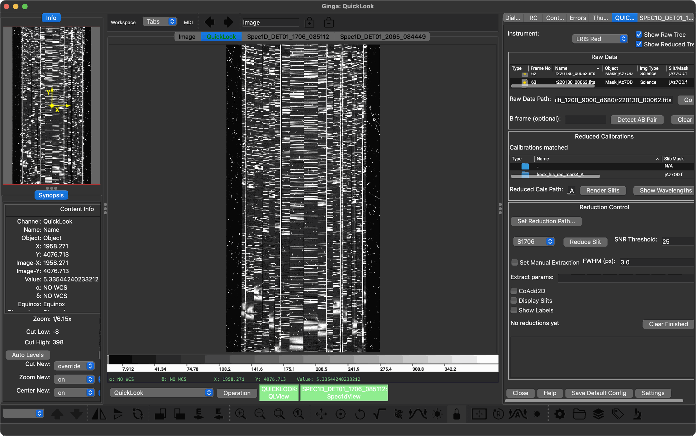
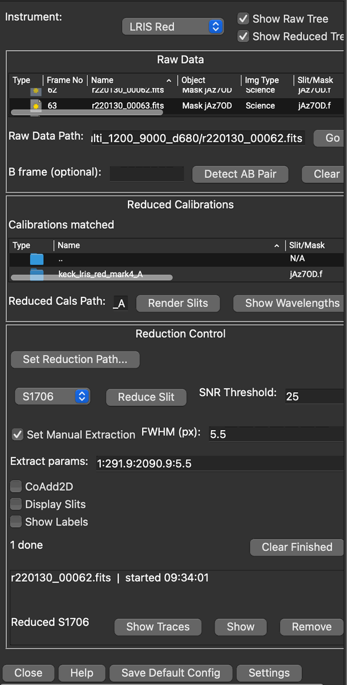
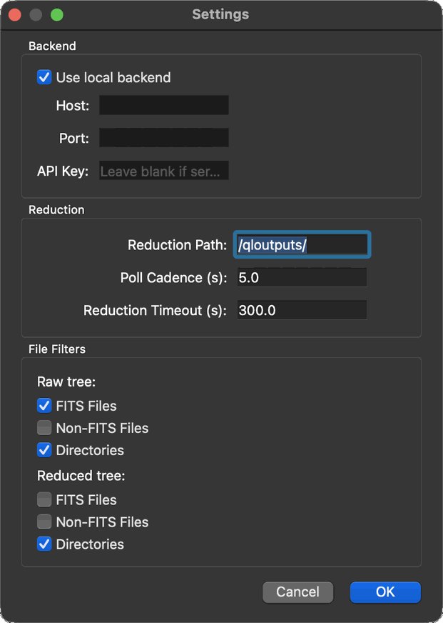

.. _quicklook_viewer:

==================
Quicklook Viewer
==================

The PypeIt Quicklook Viewer (QLView) is an interactive Ginga plugin that lets
observers browse raw frames, load reduced calibrations, render slit overlays,
and trigger the quicklook reduction pipeline from one GUI interface.

Overview
========

The PypeIt Quicklook Viewer is a GUI intended to be used throughout an observing
night. It allows a user to inspect raw data as soon as it is written to disk and,
provided calibrations exist, reduce and inspect spectra with a graphical
interface provided through Ginga.

   The QLView plugin (right) alongside Ginga's image viewer, with a raw LRIS
   red multislit frame open.

.. contents:: Contents
   :depth: 1
   :local:

Typical Workflow
================

The following describes a typical workflow for using the GUI.

#. Launch the GUI with ``pypeit_qlview`` from the command line.
#. The Plugin is launched on the right-hand side of the screen. Select your
   instrument from the dropdown at the top.
#. Optionally, click "Settings" at the bottom of the panel to choose which
   files are listed in the "Raw Data" and "Reduced Calibrations" tables, how
   often the viewer checks on running reductions ("Poll Cadence"), and how long
   a reduction may run before it is considered failed ("Reduction Timeout").
   Changes take effect when you click "OK". To start future sessions with the
   current paths, file filters, and reduction timeout, click "Save Default
   Config" (see :ref:`qlview-config`).
#. In the "Raw Data" table, navigate to where the raw science files are stored.
   Double-click a directory to enter it; selecting a file updates the "Raw
   Data Path" entry.

   Each file is listed with its name, the time it was last changed, and a set
   of instrument-specific columns read from its header (for DEIMOS, for
   example, the frame number, object, image type, mask, grating, filter, and
   exposure time). Click a column heading to sort by it.

#. In the "Reduced Calibrations" table, navigate to where the pre-processed
   calibrations are stored.

   Each setup folder (e.g. ``keck_deimos_A``) is listed with its instrument
   configuration (such as the grating or slit mask), read from the setup's
   ``.pypeit`` file, so you can tell which setup matches your science frames.

   .. note::
      The quicklook viewer does not process calibrations on its own. It is expected
      that calibrations for each science configuration used throughout the night have
      already been processed.

#. Choose where the quicklook reductions will be written: click "Set Reduction
   Path..." at the top of the "Reduction Control" section, then pick or create a
   directory in the pop-up window (you can also type a path there). Each
   reduction is written to its own subdirectory. The reduction path can also be
   changed in the Settings dialog, and saved for future sessions with "Save
   Default Config" (see :ref:`qlview-config`). If the path does not exist when
   you reduce a slit, the viewer offers to create it.
#. Select a science frame for reducing by double clicking on a file, or pressing
   the "Go" button. This will draw the raw frame onto Ginga's Image Viewer. If
   the file's ``INSTRUME`` header does not match the selected instrument, the
   viewer asks whether to switch to the matching instrument, continue anyway,
   or cancel. If you are observing using a dither pattern, the GUI can process
   AB frame pairs. Select "Detect AB Pair" to attempt to automatically pick an
   appropriate pair frame, or manually enter the path to the frame into the "B
   frame (optional)" entry; "Clear" empties it. With a B frame set, check
   "CoAdd2D" to also coadd the A and B frames in 2D.
#. Pick your calibrations. If PypeIt was able to detect a matching configuration
   amongst the calibrations in the directory you selected, it will pre-select it for
   you. Otherwise, select the setup folder for your configuration (e.g.,
   ``keck_deimos_A``) or the ``Calibrations`` folder inside it; "Render Slits" and
   "Show Wavelengths" are only enabled once one of these is selected, and the
   status line above the table says what to select until then. Then, press
   "Render Slits" to draw the slits on top of the raw image. Press
   "Show Wavelengths" to display wavelength information on top of the raw image (as
   you hover over the image, the wavelength will be shown in the lower left of the
   screen). If the calibrations were written by a version of PypeIt that this
   viewer cannot read, a "Calibrations Out of Date" warning lists the affected
   files; see :ref:`qlview-troubleshooting`.

   .. figure:: figures/qlview_figures/qlview_fullscreen_LRISR_MOS_zoomed.png
      :alt: Slits rendered on a raw frame
      :width: 90%

      Slits rendered on a raw LRIS red frame.  The selected slit is drawn in
      blue and the others in green.

   .. figure:: figures/qlview_figures/qlview_wavelength_display_LRISR_MOS.png
      :alt: Wavelength readout in the Ginga info bar
      :width: 80%

      After "Show Wavelengths", the wavelength under the cursor (here,
      :math:`\lambda = 9649.49`) is shown at the lower left of the Ginga info bar.

#. Select the slit you would like to process either by clicking directly on it,
   or selecting it from the drop-down menu next to "Reduce Slit." The selected
   slit is drawn in blue. Use "Display Slits" to show or hide the slit outlines,
   and "Show Labels" to show or hide the slit labels.
#. Pick an option for object extraction. You can either specify an SNR threshold
   for PypeIt to use to automatically detect objects, or manually select an object.
   If you select "Set Manual Extraction," you can click directly on the raw image
   to locate an object. You can specify the FWHM (in pixels) that you would like to
   use. (Tip: if you need to pan around the image after zooming in, select "Pan"
   from the toolbar. Make sure to un-select it by clicking the button again to
   return to object placement.). At the moment, manual extraction is only possible
   on one object at a time.

   .. figure:: figures/qlview_figures/qlview_manual_extraction_control.png
      :alt: Manual extraction controls
      :width: 40%

      The manual extraction controls.

   .. figure:: figures/qlview_figures/qlview_manual_extract_boxcar_marker.png
      :alt: Manual extraction marker on the raw image
      :width: 50%

      The yellow marker placed on the raw image in manual extraction mode.

#. Once you are ready to process, click "Reduce Slit". This launches a background
   process to apply the selected calibrations to that slit, following all user
   provided extraction constraints. An entry for the reduction is added to the
   top of the list of reductions at the bottom of the "Reduction Control"
   section, showing the raw file, start time, and status, with buttons to view
   the results. The list scrolls once it is full, and the line above it counts
   the reductions that are running, done, and failed. "Clear Finished" removes
   the entries for reductions that are done or failed; "Remove" removes a
   single entry. Reducing the same slit again adds a separate entry.

   .. figure:: figures/qlview_figures/qlview_reducing_buttons.png
      :alt: A reduction in progress in the reductions list
      :width: 40%

      A reduction in progress.  The "Show Traces" and "Show" buttons are disabled
      until the reduction finishes.

#. Wait for the entry's status to change from "Reducing" to "Reduced" and its
   "Show" button to become enabled, indicating the reduction is complete. Press
   the button to see the 1D spectra extracted. If "CoAdd2D" was checked, the
   entry also has a "Show CoAdd2D" button for the coadded spectra. If the
   reduction fails or runs longer than the reduction timeout, the entry is
   marked as failed.

   .. figure:: figures/qlview_figures/qlview_reduced_buttons.png
      :alt: A completed reduction in the reductions list
      :width: 40%

      A completed reduction, with the "Show Traces" and "Show" buttons enabled.

   .. figure:: figures/qlview_figures/qlview_spec1D_LRISR.png
      :alt: Spec1dView showing an extracted spectrum
      :width: 60%

      The Spec1dView plugin, open in its own channel, showing the spectrum
      extracted from LRIS red slit S1706.

#. In the Spec1D viewer, you can inspect all the object spectra that were
   extracted. Select objects using the "Extension" drop down. If you swap back to
   the QUICKLOOK tab and press "Show Traces" in the reduction's entry, the
   locations of each object will be drawn onto the raw image. You can then
   iterate through the Spec1D viewer until you find the object you wish to
   inspect.

   Each extracted object's trace is drawn on the raw image as an orange line,
   labeled with the object's name (written vertically, at the middle of the
   trace). The object currently selected in the Spec1D viewer is drawn in cyan
   instead, and the highlight follows your selection as you change the
   "Extension" drop down. For example, if only one object was extracted, you
   will see a single trace that turns from orange to cyan, because that object
   is selected in the Spec1D viewer by default.

   .. figure:: figures/qlview_figures/qlview_highlighted_slit.png
      :alt: An object trace drawn on the raw image
      :width: 50%

      An object trace drawn on the raw image with "Show Traces", labeled with the
      object's name.  If more than one object was detected, the trace selected
      in the Spec1D viewer is drawn in cyan and the others in orange.

   .. note::
      The highlighting only works while that slit's Spec1D viewer is open; if
      it is closed, all traces stay orange. Traces are also not drawn if the raw
      image currently displayed has a different instrument configuration from
      the frame that was reduced; open the matching raw frame first.
#. When ready for the next file or slit to reduce, repeat these steps (using the
   same window).

Launching the Viewer
====================

The viewer can be launched with ``pypeit_qlview``. If a Ginga window is already
open it will attach to that instance and open the plugin there, otherwise it
will open a new instance. Sometimes the GUI takes too long to render, and times
out. If this happens, re-run ``pypeit_qlview`` again and it will attach to the
Ginga window.

.. _qlview-config:

Configuration File
------------------

There are a number of customizations that can be made to how the GUI presents
information, which can be stored in a file for the next time that the GUI is run.

Primarily, it tells the GUI where the default locations for the raw data
(``raw_path``), calibrations (``reduced_path``), and extracted products
(``redux_path``) should be.  It also stores the file filters for the "Raw Data"
and "Reduced Calibrations" tables and the reduction timeout.  The backend and
poll cadence are set in the Settings dialog only, and are not saved.

This file is stored in ``~/.pypeit/quicklook.cfg`` and looks like this:

.. code-block::

    [DEFAULT]
    redux_path = /data/redux
    raw_path = /data/raw
    reduced_path = /data/reduced
    raw_show_fits = True
    raw_show_nonfits = False
    raw_show_dirs = True
    reduced_show_fits = False
    reduced_show_nonfits = False
    reduced_show_dirs = True
    reduction_timeout = 600.0

To create a config file, open the GUI and click "Save Default Config." This will
take the current status of the GUI and populate the configuration keys to match.

Startup Paths and Date Templates
---------------------------------

Each of the three paths can instead be given as a template, using the keys
``raw_path_template``, ``reduced_path_template``, and ``redux_path_template``.
Templates accept ``strftime`` format codes, which the GUI evaluates at startup
to navigate to the correct directories.  When a template key is present, it
takes precedence over the corresponding path key.  For example, if the config
file contains

.. code-block::

    [DEFAULT]
    raw_path_template = /data/%Y/%m/%d/spec

and the GUI is started on January 1st, 1970, the raw data path is set to
``/data/1970/01/01/spec``.  This can be used to set the GUI up for operational
use at an observatory without requiring direct modification of the
configuration each day.  Template keys must be added to the file by hand.

.. warning::
   "Save Default Config" overwrites the config file with the current settings,
   using plain path keys only, so any template keys in the file are lost.  Add
   them back by hand after saving.

Interface Overview
==================

   The QLView control panel, with the instrument selector at the top, followed
   by the "Raw Data", "Reduced Calibrations", and "Reduction Control" sections.
   The "Show Raw Tree" and "Show Reduced Tree" checkboxes hide or show the
   corresponding table.

Supported Instruments
---------------------

The following instruments are currently supported:

- Keck/DEIMOS (``keck_deimos``)
- Keck/LRIS red camera with the Mark4 detector, in use since May 2021
  (``keck_lris_red_mark4``).  Data taken with the earlier LRIS red detectors
  and the LRIS blue camera are not supported.  LRIS headers do not record a
  dither pattern, so "Detect AB Pair" does not find B frames for LRIS; enter
  the B frame path directly instead.  The image type shown in the file
  browser is inferred from the lamp and trapdoor status, so standard stars
  are shown as science frames.
- Keck/MOSFIRE (``keck_mosfire``)

Settings Dialog
===============

   The Settings dialog.

The Settings dialog is opened with the "Settings" button at the bottom of the
panel.  Changes are applied when you click "OK"; "Cancel" discards them.

Backend
    "Use local backend" (the default) browses files and runs reductions on
    the machine running the viewer.  The "Host", "Port", and "API Key" fields
    connect the viewer to a remote quicklook server instead; this mode is
    experimental.

Reduction Path
    The directory the quicklook reductions are written to, also set with
    "Set Reduction Path...".

Poll Cadence (s)
    How often, in seconds, the viewer checks running reductions for their
    output.

Reduction Timeout (s)
    How long, in seconds, a reduction may run before it is marked as failed.

File Filters
    Whether FITS files, non-FITS files, and directories are listed in the
    "Raw Data" and "Reduced Calibrations" tables.

The reduction path, reduction timeout, and file filters can be saved for
future sessions with "Save Default Config" (see :ref:`qlview-config`).

.. _qlview-troubleshooting:

Troubleshooting
===============

The GUI times out while starting
    Sometimes the GUI takes too long to render, and ``pypeit_qlview`` times
    out.  Run ``pypeit_qlview`` again; it attaches to the Ginga window that is
    already open.

"Render Slits" and "Show Wavelengths" stay disabled
    These buttons are enabled only when the selection in the "Reduced
    Calibrations" table is a setup folder (e.g. ``keck_deimos_A``), the
    ``Calibrations`` folder inside it, or a file in either.  Until then, the
    status line above the table says what to select.

"Calibrations Out of Date" warning
    The calibrations were written by a version of PypeIt whose datamodel
    differs from the one running the viewer, so they cannot be loaded.  The
    warning lists the affected files.  Re-reduce the calibrations with the
    version of PypeIt running the viewer, or run the viewer with the version
    of PypeIt that created them.  In particular, slit calibrations (``Slits``
    files) written before ``SlitTraceSet`` datamodel version 1.1.6 cannot be
    loaded.

Development
===========

Architecture
------------

The following is reproduced from the ``qlview.py`` module docstring and
describes the internal design of the plugin for developers who need to extend
or debug it.

``QLView`` is the top-level Ginga ``LocalPlugin`` that orchestrates the
PypeIt quicklook pipeline from within the Ginga image viewer.  It is
split into several collaborating components, each with a well-defined
responsibility:

``QLView`` (``pypeit/display/qlview/qlview.py``)
    The plugin class itself.  Owns all mutable GUI state, wires callback
    methods, and coordinates the other components.  Inherits from
    ``ginga.GingaPlugin.LocalPlugin`` and therefore follows the Ginga
    plugin lifecycle: ``build_gui`` → ``start`` → [user interaction] →
    ``stop`` / ``close``.

``QLViewState`` (``pypeit/display/qlview/state.py``)
    A lightweight dataclass that groups the current viewer state:
    the active raw filepath, reduced-calibrations filepath, reduction
    output path, loaded ``SlitTraceSet`` objects, slit polygon dict,
    and the active slit key.  Passed between methods to avoid scattering
    mutable state across ``self``.

``QLViewUI`` (``pypeit/display/qlview/ui.py``)
    Builds the entire Ginga widget tree and attaches it to the plugin
    container.  Stores every widget reference on ``self.plugin`` so that
    callback methods can reach them without navigating the widget hierarchy.
    Keeps UI construction completely separate from business logic.

PypeIt ``Spectrograph`` classes (``pypeit/display/qlview/spectrograph_support.py``, ``pypeit/display/qlview/calib_utils.py``)
    Instrument-specific behavior lives in the ``qlview_*`` hooks of
    :class:`~pypeit.spectrographs.spectrograph.Spectrograph`: reading
    display-ready raw image data (``qlview_display_image``) and extracting
    FITS header metadata for the file-browser tree columns
    (``qlview_raw_info`` / ``qlview_reduced_info``).  Spectrographs with
    ``qlview_supported = True`` are offered in the instrument selector.
    ``spectrograph_support`` adapts these hooks for the viewer, and
    ``calib_utils`` matches raw frames to their best calibration directory
    (``recommend_calibrations``).  Swapping instruments at runtime rebuilds
    the tree-view columns via ``_rebuild_treeview_columns``.

``FileBrowserController`` (``pypeit/display/qlview/file_browser.py``)
    Translates a directory path and a ``Spectrograph`` into a Ginga
    tree-view listing dict.  Delegates all filesystem access to the
    injected ``FileBrowserBackend`` so that the same controller works
    against a local disk or a remote server without changes.

``FileBrowserBackend`` / ``ReductionBackend`` (``pypeit/display/qlview/backends.py``)
    Protocol-based backend abstractions with two concrete pairs:

    - ``LocalFileBrowserBackend`` + ``LocalReductionBackend`` — operate
      on the local filesystem and run ``pypeit_ql`` in-process on a
      daemon thread.
    - ``RemoteFileBrowserBackend`` + ``RemoteReductionBackend`` — delegate
      all operations to an HTTP server via ``requests``, enabling use cases
      where the raw data lives on a remote instrument workstation.

    The local backends are used at startup; the remote backends can be
    selected at runtime through the Settings dialog.  The remote backends and
    the HTTP server they talk to
    (``pypeit/display/qlview/servers/HTTPserver.py``) are experimental and
    have not yet been tested in operation.

``SlitOverlay`` (``pypeit/display/qlview/slit_overlay.py``)
    Manages the Ginga ``DrawingCanvas`` layer that renders slit polygons
    and optional label text over the raw image.  Maintains a dict of
    ``slit_key`` → ``Polygon`` and provides ``activate`` / ``deactivate``
    methods to highlight the currently selected slit in blue.

Data Flow
~~~~~~~~~

#. **File browsing** — ``_browse_and_update`` calls
   ``FileBrowserController.browse``, which uses the active
   ``FileBrowserBackend`` to list a directory and reads per-file header
   metadata via ``Spectrograph.qlview_raw_info`` / ``qlview_reduced_info``.
   The resulting dict is pushed directly into the Ginga ``TreeView`` widget.

#. **Raw image display** — double-clicking a FITS file calls
   ``open_raw_file``, which delegates mosaic assembly to
   ``Spectrograph.qlview_display_image`` and loads the result into the Ginga
   ``AstroImage`` canvas.

#. **Calibration suggestion** — after a raw file is opened,
   ``_suggest_calibrations`` calls ``calib_utils.recommend_calibrations``
   on a background thread, then highlights the best-matching calibration
   directory in the reduced tree on the GUI thread via ``fv.gui_do``.

#. **Slit rendering** — ``render_slits_cb`` reads ``Slits_*.fits*`` from
   the calibration ``Calibrations/`` directory, loads them as
   ``SlitTraceSet`` objects, and hands them to ``SlitOverlay.build`` to
   draw polygons on the ``slit_canvas`` ``DrawingCanvas`` layer.

#. **Reduction** — ``reduce_slit_cb`` assembles the ``pypeit_ql``
   argument list and calls ``ReductionBackend.submit`` on a daemon thread.
   A Ginga timer (``_register_reduction_timer``) polls for output files
   every ``reduction_cadence`` seconds on the GUI thread, enabling and
   wiring the "Show" button when the ``spec1d`` file appears.

#. **Trace overlay** — once reduction is complete, ``show_traces_cb``
   loads the ``SpecObjs`` from the ``spec1d`` file on a background thread
   and draws per-object ``TRACE_SPAT`` paths in orange on a per-slit
   ``DrawingCanvas``.  A polling timer watches the paired ``Spec1dView``
   plugin for selection changes and recolors the active trace cyan.

Configuration Keys
~~~~~~~~~~~~~~~~~~

``~/.pypeit/quicklook.cfg`` (INI format, ``[DEFAULT]`` section) controls startup
paths, file-filter defaults, and reduction timeout; see :ref:`qlview-config`.
The ``*_path_template`` keys support ``strftime``-style format codes (e.g.
``raw_path_template = /data/raw/%Y%m%d``) that are expanded at startup, and
take precedence over the plain path keys.  The "Save Default Config" button
(``create_config_cb``) overwrites the file with the current settings, without
template keys.  The backend and poll cadence are not read from or written to
the file.

Adding a New Instrument
-----------------------

Overview
~~~~~~~~

Instrument-specific behavior of the viewer is defined by the ``qlview_*``
hooks of the instrument's PypeIt spectrograph class (see
:class:`~pypeit.spectrographs.spectrograph.Spectrograph`).  Adding an
instrument to the viewer requires:

#. Setting ``qlview_supported = True`` and ``qlview_label`` (the name shown
   in the instrument selector) in the spectrograph class.
#. Overriding the ``qlview_*`` methods described below, as needed.

No changes to ``QLView``, ``QLViewUI``, ``FileBrowserController``, or any
backend are needed.  Throughout the viewer, including the remote HTTP API,
the instrument is identified by the spectrograph's PypeIt ``name`` (e.g.
``keck_deimos``); the ``INSTRUME`` header check uses its ``header_name``.

The ``qlview_*`` methods are only used by the viewer, never by the
reduction pipeline, and they must not modify the spectrograph instance.

Hooks
~~~~~

``qlview_raw_columns()``
    Return the instrument-specific raw-file columns as a list of
    ``(display_name, key)`` tuples.  The viewer adds the type-icon, file
    name, and modification-time columns itself; the file name follows a
    leading ``FRAMENO`` column, if present.

``qlview_raw_info(hdr)``
    Return a ``dict`` mapping each ``key`` in ``qlview_raw_columns()`` to
    its value in the primary header of a raw file.  Missing keywords must
    give ``"N/A"``.  The Keck spectrographs use
    :func:`~pypeit.spectrographs.keck_utils.koa_qlview_header_fields` for
    the common KOA keywords.

``qlview_reduced_columns()``
    Return the columns for the reduced-calibrations tree.  Each ``key`` is a
    PypeIt configuration key (see ``configuration_keys()``), which lets the
    viewer fill the columns for a calibration directory (e.g.
    ``keck_deimos_A/``) from the setup block of its ``.pypeit`` file.  By
    default, there is one column per configuration key.

``qlview_reduced_info(hdr)``
    Return a ``dict`` of the reduced-tree column values for an individual
    reduced FITS file.  By default, this is empty.

``qlview_display_image(raw_path)``
    Return the 2-D ``numpy.ndarray`` displayed for a raw file.  It must be in
    the same coordinate frame as the ``SlitTraceSet`` objects produced by
    the reduction, so that slit overlays are registered correctly.  By
    default, the first detector is processed with the ``biasframe``
    parameters; instruments with detector mosaics (e.g. DEIMOS) typically
    concatenate the mosaics along the spatial axis.

Example
~~~~~~~

.. code-block:: python

    class MySpectrograph(spectrograph.Spectrograph):
        ...

        qlview_supported = True
        qlview_label = 'MyInstrument'

        def qlview_raw_columns(self):
            return [('Object', 'OBJECT'), ('Grating', 'GRATING'),
                    ('Exp Time', 'EXPTIME')]

        def qlview_raw_info(self, hdr):
            return {'OBJECT': hdr.get('OBJECT', 'N/A'),
                    'GRATING': hdr.get('GRATNAME', 'N/A'),
                    'EXPTIME': hdr.get('EXPTIME', 'N/A')}

        def qlview_reduced_columns(self):
            return [('Grating', 'dispname'), ('Slit', 'decker')]

.. include:: include/links.rst
